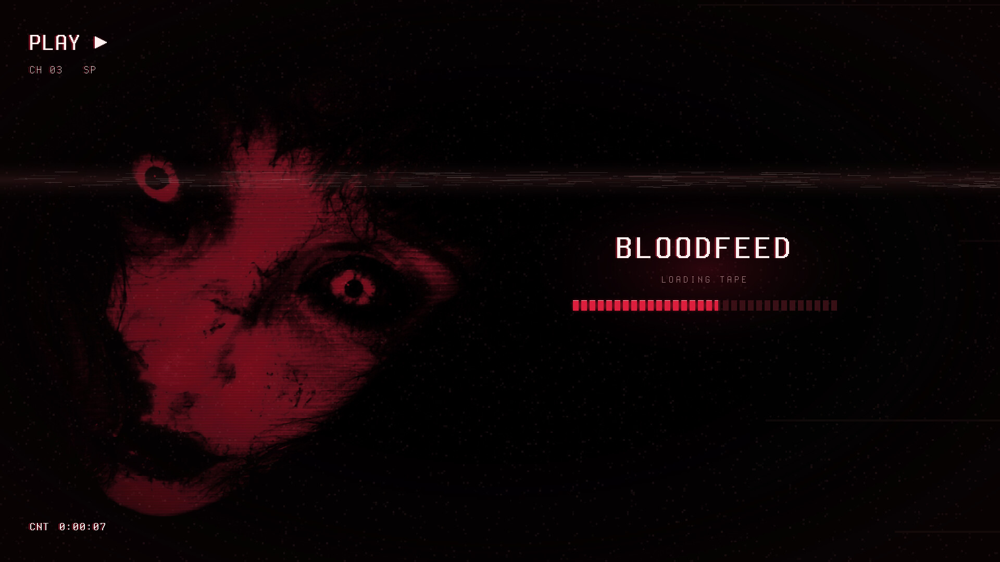
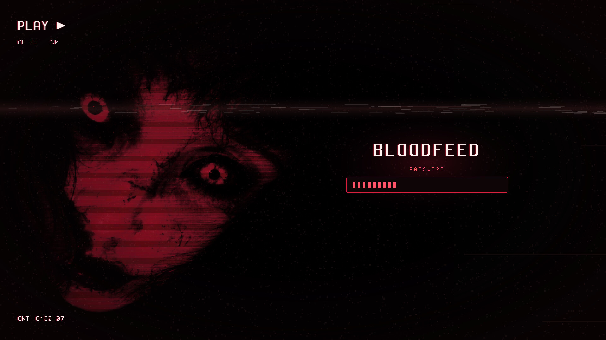
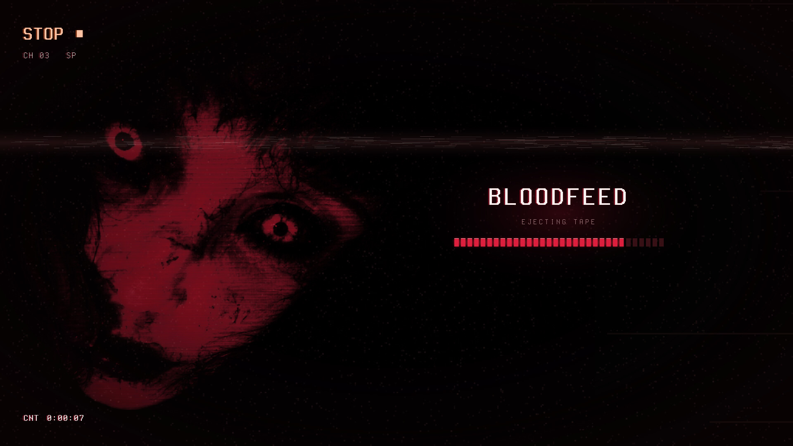

# Bloodfeed — Plymouth Boot Splash

Blood-dubbed VHS boot splash: the crimson face under scanlines and grain, a rolling tracking band, VCR OSD, tape-block progress.



Bloodfeed is a blood-dubbed VHS look for KDE Plasma 6, built around a crimson-lit face on near-black: blood-black surfaces, faint scanlines and tape grain, and a slight crimson glow on whatever has focus.

## Features

- Live grain, a tracking band rolling top to bottom, and an occasional tape wobble of the picture.
- VCR OSD: `PLAY ▶` blinks while the deck engages, plus `CH 03 SP` and a tape counter that ticks every second.
- Boot progress as a strip of 32 crimson tape blocks under a glowing **BLOODFEED**.
- Shutdown shows `STOP ■` / **EJECTING TAPE**, reboot shows `REW ◀◀`.
- Disk-unlock prompt (LUKS): a glowing field with block bullets.
- Every word is pre-rendered, so no fonts are needed in the initramfs. Laid out for 16:9 and scaled by screen height.




## Requirements

Plymouth with the `script` plugin (standard).

## Install

```bash
git clone https://github.com/numbpill3d/bloodfeed-plymouth
cd bloodfeed-plymouth && sudo ./install.sh
```

Or from the KDE Store: Extract to `/usr/share/plymouth/themes/`, then `sudo plymouth-set-default-theme -R bloodfeed` (on dracut systems: `sudo plymouth-set-default-theme bloodfeed && sudo dracut -f`).

## Configuration

Make sure `splash` is on the kernel command line.

## The rest of the suite

| piece | repo |
|---|---|
| SDDM login | [bloodfeed-sddm](https://github.com/numbpill3d/bloodfeed-sddm) |
| Global theme + splash screen | [bloodfeed-global](https://github.com/numbpill3d/bloodfeed-global) |
| Plasma style (panel, popups) | [bloodfeed-plasma](https://github.com/numbpill3d/bloodfeed-plasma) |
| Aurorae window decoration | [bloodfeed-aurorae](https://github.com/numbpill3d/bloodfeed-aurorae) |
| Colour scheme | [bloodfeed-colors](https://github.com/numbpill3d/bloodfeed-colors) |
| Kvantum widget style | [bloodfeed-kvantum](https://github.com/numbpill3d/bloodfeed-kvantum) |
| Icon theme | [bloodfeed-icons](https://github.com/numbpill3d/bloodfeed-icons) |
| Konsole + kitty colours | [bloodfeed-konsole](https://github.com/numbpill3d/bloodfeed-konsole) |

Everything at once, with the generators: [bloodfeed](https://github.com/numbpill3d/bloodfeed).

## Tags

`bloodfeed` `kde` `plasma6` `dark` `vhs` `scanlines` `crimson` `red` `blood` `horror` `retro` `analog-horror` `glow` `plymouth` `plymouth-theme` `boot-splash` `bootscreen` `luks`

## Credits and licence

By splicer scorn (voidrane). GPL-3.0-or-later.
